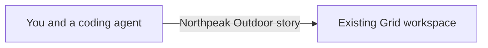

# Frontline demo for Slack

Northpeak Outdoor is a fictional sports and outdoor retailer. This repository stages the Slack Frontline webinar in the existing Enterprise Grid workspace: Alex on a phone, Sam on desktop, then Jordan at HQ. Alex, Sam, Jordan, Riley, Casey, and Jamie are the only Slack users this sandbox should add. Later demos reuse them.

There is no Salesforce step. The Slack app in [`slack/manifest.json`](slack/manifest.json) creates the workspace and posts the staged script. People do not message the app. The procedure is [`AGENT.md`](AGENT.md).



Install the app once, on the Slack Enterprise Grid org, and grant it to the existing workspace. Later demos reuse that workspace and the same six people.

## Manual setup

The first two steps are once per org. The rest are once per workspace, before the webinar.

### 1. Install the workspace app on the org

Create a Slack app from [`slack/manifest.json`](slack/manifest.json): Slack API, Create New App, From a manifest. Install it on the Enterprise Grid org, not on one workspace. Grant it to future workspaces. Approve it if the org requires an admin.

The app has no slash command and no conversation. Reinstall it after any manifest change so Slack grants the new scopes. The org-admin user token from that install creates the workspace, invites users, and stages channels, canvases, and messages.

### 2. Store the tokens

Keep `SLACK_ADMIN_TOKEN` in the coding agent's secret store. Persona tokens are `SLACK_TOKEN_ALEX`, `SLACK_TOKEN_SAM`, `SLACK_TOKEN_JORDAN`, `SLACK_TOKEN_RILEY`, `SLACK_TOKEN_CASEY`, and `SLACK_TOKEN_JAMIE`. Do not commit them. Do not create a new Slack user for another demo.

### 3. Give the agent this story

```text
Follow AGENT.md in this repository.
```

The agent updates the existing workspace for Northpeak Outdoor, adds the channels, tabs Sam's canvas into `#onboarding-alex`, and posts the staged history as each person whose token it has. It then stops on the gates that are still open.

### 4. Finish the gates before you present

- Alex is a Frontline Member on exactly `#onboarding-alex`, `#store-stockholm`, and `#announcements`. Sam, Jordan, Riley, Casey, and Jamie are Full Members.
- I've read the guide and Report low stock are bookmarked. The New starters List is a tab in `#stockholm-leads`.
- Jordan's transfer reply stays unsent until Alex has raised the low stock.
- Beat 1 is recorded as a fallback. Phone mirroring is tested. Sam and Jordan have separate Chrome profiles.

The live demo does not include a huddle or an admin invite.

## Commands

```bash
node scripts/plan.test.mjs
node scripts/seed.test.mjs
node scripts/seed.mjs
node scripts/seed.mjs --apply
node scripts/seed-list.mjs
```

The dry-run prints the workspace, the Slack calls, the talk track, and the live lines. `--apply` calls Slack and writes `demos/northpeak-outdoor.links.json`, which is gitignored. `seed-list.mjs` creates the New starters list with `SLACK_BOT_TOKEN` (the bot token Slack grants `lists:write`), shares it into `#stockholm-leads`, and makes Sam the owner.

[demos/northpeak-outdoor.json](demos/northpeak-outdoor.json) is the plan the tests lock to the brief. It is fictional.

## What the agent will leave to you

- Installing the workspace app on the Enterprise Grid org and granting it to future workspaces.
- Storing the org-admin token and any persona tokens.
- Turning Alex into a Frontline Member and confirming the three-channel home.
- Reinstalling the app after `lists:write` is added, then building I've read the guide and Report low stock.
- Pasting any staged line whose persona token was missing.
- Recording Beat 1 as a fallback.

## License

[MIT](LICENSE)
