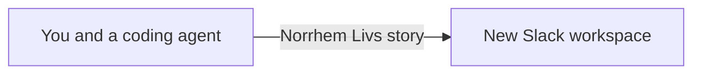

# Frontline demo for Slack

Norrhem Livs is a fictional Nordic grocery chain. This repository stages the Slack Frontline webinar in a new Enterprise Grid workspace: Linnea on a phone, Morgan on desktop, then Harry at HQ.

There is no Salesforce step. The Slack app in [`slack/manifest.json`](slack/manifest.json) creates the workspace and posts the staged script. People do not message the app. The procedure is [`AGENT.md`](AGENT.md).



Install the app once, on a Slack Enterprise Grid org, and grant it to workspaces created later. Each demo is a new workspace.

## Manual setup

The first two steps are once per org. The rest are once per workspace, before the webinar.

### 1. Install the workspace app on the org

Create a Slack app from [`slack/manifest.json`](slack/manifest.json): Slack API, Create New App, From a manifest. Install it on the Enterprise Grid org, not on one workspace. Grant it to future workspaces. Approve it if the org requires an admin.

The app has no slash command and no conversation. The org-admin token from this install creates each workspace.

### 2. Store the tokens

Keep `SLACK_ADMIN_TOKEN` in the coding agent's secret store. Persona tokens are `SLACK_TOKEN_MORGAN`, `SLACK_TOKEN_HARRY`, `SLACK_TOKEN_LINNEA`, and the same pattern for the other people named in the plan. Do not commit them.

### 3. Give the agent this story

```text
Follow AGENT.md in this repository.
```

The agent creates a workspace named Norrhem Livs, adds the channels, tabs Morgan's canvas into `#onboarding`, and posts the staged history as each person whose token it has. It then stops on the gates that are still open.

### 4. Finish the gates before you present

- Linnea is a Frontline Member on her five channels. Morgan and Harry are Full Members.
- The three workflows are bookmarked, and Acknowledge is a button on Harry's 08:45 price change.
- Linnea's fridge 4 reply stays unsent until Morgan has replied.
- Beat 1 is recorded as a fallback. Phone mirroring is tested. Morgan and Harry have separate Chrome profiles.

The live demo does not include a huddle or an admin invite.

## Commands

```bash
node scripts/plan.test.mjs
node scripts/seed.test.mjs
node scripts/seed.mjs
node scripts/seed.mjs --apply
```

The dry-run prints the workspace, the Slack calls, the talk track, and the live lines. `--apply` calls Slack and writes `demos/norrhem-livs.links.json`, which is gitignored.

[demos/norrhem-livs.json](demos/norrhem-livs.json) is the plan the tests lock to the brief. It is fictional.

## What the agent will leave to you

- Installing the workspace app on the Enterprise Grid org and granting it to future workspaces.
- Storing the org-admin token and any persona tokens.
- Turning Linnea into a Frontline Member and assigning her five channels.
- Building the four workflows in Workflow Builder and testing them on a phone.
- Pasting any staged line whose persona token was missing.
- Recording Beat 1 as a fallback.

## License

[MIT](LICENSE)
